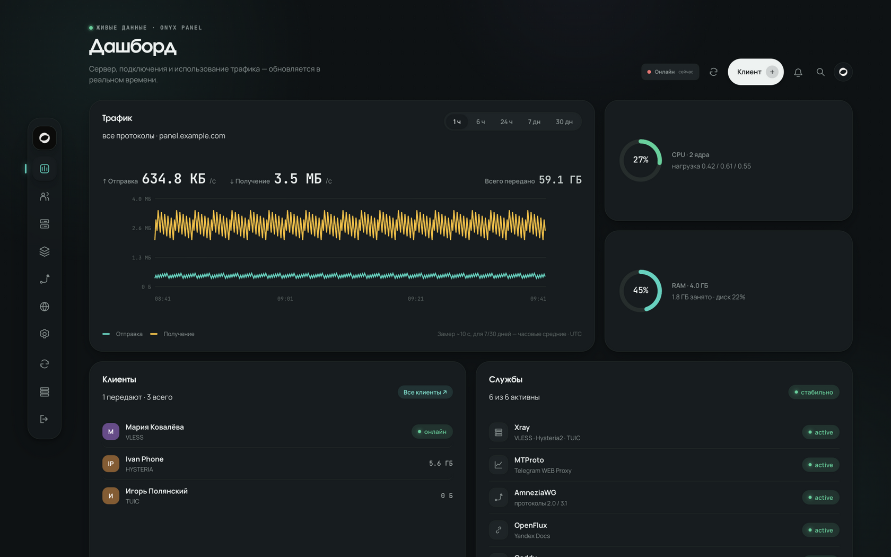

<p align="center">
  <picture>
    <source media="(prefers-color-scheme: dark)" srcset="onyx-panel-white.svg">
    
  </picture>
</p>

<p align="center"><b>Панель управления VPN на своём VPS.</b><br>
VLESS XHTTP + Reality · Hysteria2 · TUIC 5 · AmneziaWG 2.0/3.1 · MTProto · Telegram Web Proxy · OpenFlux · Каскады панелей · Антиреклама</p>

<p align="center">
  <b>Русский</b> · <a href="README.en.md">English</a>
</p>

<p align="center">
  <a href="https://github.com/xCodeOn/Onyx-Panel/releases/latest"></a>
  <a href="LICENSE"></a>
  <a href="https://github.com/xCodeOn/Onyx-Panel/actions/workflows/tests.yml"></a>
  
  <a href="https://github.com/xCodeOn/Onyx-Panel/stargazers"></a>
</p>

<p align="center">
  <a href="https://pay.cloudtips.ru/p/22326183"></a>
</p>

## Скриншоты

<p align="center">
  <a href="docs/screenshots/dashboard.png"></a>
</p>

## Что внутри

| | |
|---|---|
| **Протоколы** | VLESS XHTTP (TLS через ваш домен) и VLESS Reality · Hysteria2 (QUIC) · TUIC 5 · AmneziaWG 2.0/3.1 с полным профилем на клиента · MTProto · Telegram Web Proxy · туннели OpenFlux через публичные документы Яндекса и Mail.ru |
| **Подписки** | Одна ссылка на все протоколы или отдельный ключ на устройство · QR-коды · лимит устройств по HWID · сроки доступа · месячные квоты трафика, видимые клиенту (`subscription-userinfo`) · одноразовые ссылки-приглашения |
| **Антиреклама** | DNS-блоклист OISD с ежедневным обновлением режет рекламу и трекеры для всех протоколов сразу · свои списки блокировок и исключений · работает и для AWG-клиентов |
| **Каскады панелей** | Гоните трафик через другую панель по её `vless://` ключу · несколько каскадов с приоритетом · режим «все» или «выбранные клиенты» · живой замер задержки и выходного IP · автоматический failover |
| **Маршрутизация** | Прямые правила по IP и доменам с пресетами стран (geoip/geosite) · домены «только IPv4» · блокировка торрентов · правила считаются до каскада |
| **Ноды** | Объединение нескольких VPS в одну подписку через токен Node API · живые статусы, версии и скорости |
| **Бэкапы** | Ежедневный архив локально и в Telegram · облака — Яндекс Диск, Mail.ru Облако, Google Drive, у каждого свои ключи (0600) · «Сделать сейчас» с живым прогрессом · восстановление с предпросмотром |
| **Мониторинг** | Алерты по CPU/RAM/диску/load в колокольчик и Telegram · графики трафика за 24 ч / 7 дн / 30 дн · спарклайны по клиентам · живой `journalctl` в браузере · диагностика без SSH |
| **Безопасность** | TOTP-2FA · наблюдатель с доступом только на чтение · журнал входов с распознаванием новых устройств · ханипот с автобаном сканеров на 24 часа · правила UFW и открытые порты прямо в панели · секретный адрес панели |
| **Автоматизация** | REST API с Bearer-ключами для ботов и биллинга · обновления панели и компонентов с автоматическим откатом · Telegram-уведомления о каждом событии |
| **Интерфейс** | Тёмный glass-дизайн · устанавливаемый PWA с push-уведомлениями · палитра команд (`Ctrl+K`) · редактор страницы-заглушки с живым превью · журнал действий · русский и английский UI с автоопределением языка браузера |

## Быстрый старт

Подключитесь к чистому VPS по SSH и выполните одну команду:

```bash
bash <(curl -fsSL https://raw.githubusercontent.com/xCodeOn/Onyx-Panel/main/install.sh)
```

Установщик скачивает последний стабильный релиз и настраивает всё сам — Caddy с сертификатом, Xray, AmneziaWG, MTProxy, relay и панель. Спросит домен, почту для сертификата и логин администратора, затем покажет **секретный адрес панели** вида `https://ваш-домен/panel-…`. Сохраните его: без этого адреса панель не открывается.

**На сервере ничего не собирается и не скачивается из сторонних источников.** Все компоненты (Xray, Caddy, relay tproxy-server, MTProto-прокси, AmneziaWG, OpenFlux) лежат предсобранными прямо в репозитории с проверкой контрольных сумм — установка занимает минуты, а не десятки минут, и не зависит от доступности чужих репозиториев.

### Требования

- Чистый VPS: **Ubuntu 22.04/24.04 или Debian 12**, x86_64, доступ root.
- Домен с A-записью на сервер, свободные порты **80/tcp и 443/tcp**.
- Порты протоколов показываются при создании клиентов — откройте их в фаерволе хостера.

| Назначение | Порт |
|---|---:|
| HTTP и выпуск сертификата | `80/tcp` |
| HTTPS, панель, VLESS, Web Proxy | `443/tcp` |
| Hysteria2 | `8443/udp` |
| TUIC 5 | `9443/udp` |
| MTProto | `2398/tcp` (по умолчанию) |
| AmneziaWG | `52000–52999/udp` (назначает панель) |

## Антиреклама

Встроенный блокировщик рекламы работает на уровне DNS (unbound + ежедневно обновляемый блоклист OISD): рекламные и трекерные домены перестают резолвиться для всех клиентов панели — VLESS, Hysteria2, TUIC и AmneziaWG. Свои списки блокировок и исключений — в настройках.

Честно: **рекламу YouTube, Instagram и TikTok невозможно отрезать на стороне сервера** — эти сервисы отдают рекламу с тех же доменов, что и контент, и ни один VPN этого не изменит. Рабочие варианты ставятся на устройство: uBlock Origin или SponsorBlock в браузере, ReVanced на Android. Всё остальное блокировщик режет везде.

## Каскады панелей

Панель умеет гонять трафик через другую панель: клиенты подключаются к вашему серверу как обычно, а в интернет выходят с адреса вышестоящей панели.

1. Скопируйте `vless://` ключ клиента на вышестоящей панели (раздел «Клиенты»).
2. В вашей панели откройте **Каскад → Добавить каскад** и вставьте ключ.
3. Панель проверит ключ живым запросом, покажет задержку и выходной IP и включит каскад.

Дальше: режим «все VLESS и Hysteria2» или «выбранные клиенты», несколько каскадов с приоритетом, мгновенное отключение. Поддерживаются и ключи сторонних Xray-панелей (TCP, WebSocket, gRPC, XHTTP, HTTPUpgrade, HTTP/2; TLS и Reality).

## Маршрутизация

Вкладка «Маршрутизация» решает, что идёт мимо каскада: прямые списки IP и доменов (с пресетами стран), домены «только IPv4» и блокировка торрентов. Значения — обычный синтаксис правил Xray (`geoip:`, `geosite:`, `domain:`, `regexp:`), поэтому работают любые готовые списки.

## Обновления и бэкапы

```bash
onyx-panel-update      # обновить панель до последнего релиза
ONYX                   # консольное меню: домен, логин, сертификат, удаление
onyx-panel-uninstall   # полное удаление
```

Всё то же доступно и из веб-интерфейса. Перед каждым обновлением автоматически создаётся бэкап; если новая версия не запустилась, прежняя восстанавливается сама. Компоненты (Xray, OpenFlux) обновляются независимо — тоже с проверкой запуска и откатом.

## Внешний API

Для ботов и биллингов: создайте ключ в **Настройки → Безопасность → Внешние API-ключи** (токен показывается один раз) и отправляйте его как `Authorization: Bearer <токен>`.

| Метод | Путь | Описание |
|---|---|---|
| GET | `/api/v1/ping` | проверка связи |
| GET | `/api/v1/clients` | список клиентов: трафик, статус, срок, ссылка |
| POST | `/api/v1/clients` | создать клиента — `{"name":"…","protocol":"vless","devices":1}` |
| POST | `/api/v1/clients/<id>/renew` | продлить доступ — `{"days":30}` |
| POST | `/api/v1/clients/<id>/toggle` | включить/выключить — `{"enabled":false}` |
| POST | `/api/v1/clients/<id>/delete` | удалить клиента |
| GET | `/api/v1/clients/<id>/link` | ключ-ссылка клиента |

```bash
curl -s -H "Authorization: Bearer onx_…" https://ваш-домен/panel-…/api/v1/clients
curl -s -X POST -H "Authorization: Bearer onx_…" -d '{"name":"Друг","protocol":"vless"}' \
  https://ваш-домен/panel-…/api/v1/clients
```

## Заметки о безопасности

- Ссылки подписок, токен Node API и адрес панели — секреты. Никогда их не публикуйте.
- Бэкапы содержат ключи доступа — храните их как пароли.
- OpenFlux переносит только IPv4/TCP; UDP и IPv6 через него не работают.

## Участие в разработке

Отчёты об ошибках и идеи — [создайте issue](https://github.com/xCodeOn/Onyx-Panel/issues/new/choose). Для локальной работы с кодом см. [CONTRIBUTING.md](CONTRIBUTING.md); тест-сьют запускается на каждый пуш.

## Поддержать проект

Панель бесплатна и пишется в свободное время. Если она вам полезна — звезда и донат лучшее спасибо:

<p align="center">
  <a href="https://pay.cloudtips.ru/p/22326183"></a>
</p>

## Лицензия

MIT. Подробности — в [LICENSE](LICENSE).
